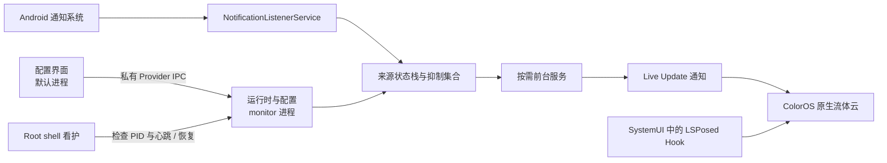
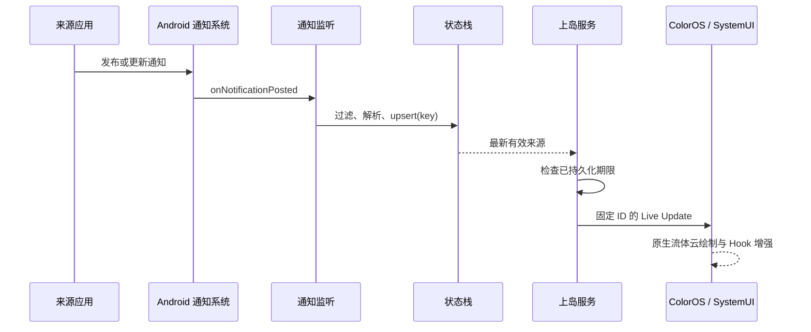

# 云漾的设计思路与工作流程

## 要解决的问题

部分应用的普通通知无法直接进入 ColorOS 流体云。云漾采用“通知中转”的思路：监听用户允许的来源，把内容转成云漾自己的 Live Update，再交给系统绘制原生流体云。它不修改 QQ、微信 APK，也不伪造来源包身份。系统中转通知归属于云漾，面板内显示来源应用名称并保留原通知的点击行为。

最初参考 notification-island 的“有权限的中转应用持有提升通知”原理。本工程把脚本侧监听、规则、状态和 Root 看护收进 APK，以系统通知监听代替外部脚本。UI 采用浅蓝色、圆角卡片和浮动导航；应用本身负责选择和调参，接收通知无需让配置界面驻留。

## 三个职责，两类应用进程

| 职责 | 所在位置 | 生命周期 |
| --- | --- | --- |
| 配置界面 | 默认进程，`MainActivity` / `CloudUi` | 用户打开时运行，移除最近任务不主动停止监测 |
| 通知监测与状态 | `:monitor`，`IslandNotificationListener` / `IslandRuntimeProvider` | 系统绑定监听，恢复任务与 Root 看护辅助重连 |
| 流体云通知呈现 | 同一个 `:monitor`，`IslandForegroundService` | 有有效消息时启动，无消息时注销并移除前台通知 |

“监测服务”和“呈现服务”是独立组件，**并非两个独立服务进程**；它们共享 `:monitor` 内存状态，以减少事件转发和同步延迟。Root 看护为 `su` 启动的独立 shell 进程。



## 从消息到上岛

1. `onNotificationPosted()` 收到系统回调。过滤本应用、未勾选包和分组摘要，避免自转发与重复摘要。
2. `IslandState.Item` 提取来源包、通知唯一 key、标题、正文、时间、原始 `PendingIntent`。QQ / 微信从最新 MessagingStyle 消息读取发送者，缺失时退回通知标题；其他应用读取应用名。
3. 来源图标按“大图标 / 头像 → 小图标 → 应用图标”选择，并在本应用进程转成 96×96 bitmap，减少跨包 URI 访问问题。
4. 相同 key 更新旧项并移到栈顶；抑制集合不随内容更新清除。最新的未抑制项成为当前候选。
5. 已运行的前台服务直接重绘；尚未运行则请求 `startForegroundService()`，进入前台后使用固定渠道和 ID 更新同一条通知。
6. Android 17 路径调用 `setRequestPromotedOngoing(true)`、`setOngoing(true)` 与短状态文本。最终是否提升、在哪里显示及动画时序由 ColorOS 决定。
7. 入站快路径之后再做使用情况访问检查；周期性活动通知同步每 3 秒补齐状态、修剪失效来源并更新监听心跳。



## 单槽位与下岛规则

内存栈最多保留 64 个来源项，按最新事件优先；同时只发布一个中转通知。原始通知仍由来源应用负责，云漾下岛不会删除原通知。

| 事件 | 状态变化 | 岛上结果 |
| --- | --- | --- |
| 新 key 到达 | 插入栈顶 | 最新有效项接替 |
| 当前通知更新 | 替换内容，不清抑制，不延长已有期限 | 未抑制时更新 |
| 手动下岛 / 到期 | key 加入抑制集合 | 显示前一条有效项；无候选则停止呈现 |
| 点击“打开” | 先抑制并重绘，再执行原 `PendingIntent` | 当前项下岛，进入原点击目标 |
| 用户直接进入来源应用 | 使用情况事件识别后抑制该包的候选 | 约受 3 秒同步周期影响 |
| 原通知移除 | 删除项、抑制状态和期限 | 恢复前一条有效项 |
| 原通知移除后重新发布 | key 对应状态已清理 | 可再次上岛 |

期限在某个候选第一次被呈现时建立，不是统一从原通知时间计时；被新消息暂时覆盖的旧项仍保留原期限。进程重建不会重置期限。显式修改停留时长会清空已保存期限，当前与排队项按新设置重新计时。无有效项时移除前台通知并 `stopSelf()`，监测组件继续绑定。

## 状态与跨进程边界

- `IslandRuntime` 是配置页的异步 IPC 客户端。后台 Binder 死亡后最多重新获取 Provider 一次，权限拒绝不重试。Root 按钮通过请求 ID 避免同进程内重复部署；回调丢失可通过状态轮询恢复按钮，并在 45 秒后解除等待。进程重建会丢失操作 ID，随后读取持久化授权结果；暂时通信失败不会覆盖已保存的 Root 状态。
- `IslandRuntime`未导出的 `IslandRuntimeProvider` 仅接受同 UID 或 Root 调用，并将命令串行化到 monitor 主线程。
- 允许列表、时长、显示开关、Root 状态、抑制 key 和期限保存在应用私有 SharedPreferences，由 monitor 持有。配置页不直接读写这份偏好，避免多进程缓存不一致。
- 标题、正文、bitmap、原通知及点击 Intent 主要留在内存；监听重连后通过 `getActiveNotifications()` 重建。通知 key 和期限会持久化，直至原通知移除或同步修剪。
- 内部接口以当前源码为准，例如 `status`、`selection`、`duration`、`presentation`、`stop`、`test`、`refresh`、`root_initialize`。不把它们当作可供其他应用调用的公开 API。

## LSPosed 为什么只作用于 SystemUI

核心监听和 Live Update 发布使用公开 API。SystemUI Hook 只增强云漾中转通知的呈现：从自有 extras 取完整短状态正文，定位 `right_section` 开启原生 TextView marquee；在 `left_section` 绑定来源图标，并显示联系人或应用名称。展开面板正文保持普通文本。

滚动使用视图自身的 marquee，不定时截字、不循环重发通知，避免反复触发上岛动画。1.8.1 为已绑定的右侧标题添加绘制前校正：系统重设单行、宽度、ellipsize 或 selected 后恢复滚动；属性正确时不重复设置文本和选择状态。窗口宽度按前四个 Unicode 码点实际测量，避免窄英文不足四个 em 而不滚动；复用或关闭滚动后恢复原属性，分离时移除绘制观察器。Hook 识别带有本包标记的通知，但目前还依赖 `capsule`、`left_section`、`right_section` 等 ColorOS 资源结构，ROM 更新需要重新验证。当前文本匹配与单槽位记忆也有局限，不能宣称对所有插件版本完全通用。

## Root 看护与恢复

首次进入界面调用 `root_initialize`。monitor 先持久保存 `root_setup_attempted`，已有 `root_enabled` 的安装直接沿用；未启用时请求一次 `su` 并部署看护。拒绝或失败不会每次进界面自动重试；该标记与 Root 管理器的长期授权是两个独立状态。

授权后 APK 部署：

```text
/data/adb/notification_island/watchdog-v4.sh
/data/adb/notification_island/enabled
/data/adb/notification_island/lock/pid
/data/adb/service.d/notification-island.sh
```

- 把本应用加入 Doze 白名单，并允许本应用使用情况访问以辅助自动下岛。
- 看护每 2 秒检查 monitor 的进程名、UID、PID 和心跳；仅对本应用 monitor 调整 `oom_score_adj`、解除对应 cgroup 冻结，不保护来源应用。
- 进程缺失或心跳超过 12 秒时尝试 Root Provider `refresh`；恢复节流为 8 秒。超过 20 秒仍失联才尝试重绑已授权的监听器，不在健康时循环通知授权。
- 收到真实消息后，若 50 毫秒仍未创建呈现服务，Root 回退针对本 UID 解除 ColorOS Hans 冻结并尝试启动。该检查间隔不是“通知 50 毫秒内必达”的承诺。
- 开机脚本等系统启动及用户解锁后恢复；BootReceiver、包更新广播和最短 15 分钟的持久 JobScheduler 任务提供补充恢复。
- 看护和恢复任务仍需执行 su；“首次授权”指用户只需作出首次授权决定，不代表后续从不使用 Root。系统或其他管理器显式强停仍可能导致恢复延迟。

## 性能与已知边界

1.8.1 移除服务启动时的重复 Live Update 提交，首次展示期限改为内存立即生效、异步写盘；意外掉电前最后一次期限写入可能丢失。小资源图标使用容量受限、含包更新时间的缓存，大图标仍按通知更新读取。监听令牌失效时标记断连，并只在用户已授权时请求重绑。

消息入口不查询 UsageStats，不跨默认进程转发事件；已有服务直接更新，应用名及应用图标缓存避免重复加载。诊断中的 `relay_latency_ms` 仅统计本模块回调到提交通知，不能衡量来源网络推送、系统排队或流体云动画。

当前重点覆盖指定 ColorOS 真机，尚不能承诺其他 ROM、所有聊天通知格式、整机重启和底栏多指/取消手势的完整覆盖。构建成功、测试通知成功和真实应用后台转发成功是三种不同证据，提交适配反馈时应分别说明。
